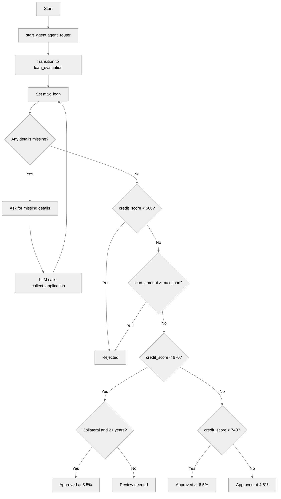

# ConditionalLogicPatterns

## Overview

This recipe demonstrates how to write **if/else logic** in Agent Script. The agent evaluates a loan application with an `if` / `else if` / `else` chain and combines checks with `and`, `or`, and `not`.

## Agent Flow



## Key Concepts

- **if / else if / else**: Check conditions in order and run only the first branch that matches
- **Combined conditions**: Join checks with `and`, `or`, and `not`
- **Order of branches**: Each branch only sees the cases that earlier branches ruled out
- **Calculated values**: Store the result of an expression in a variable and reuse it in conditions

## How It Works

### Calculating a Limit

```agentscript
set @variables.max_loan = @variables.annual_income + @variables.annual_income + @variables.annual_income
```

Arithmetic supports `+` and `-`. To compare the loan with three times the income, add the income three times and store the result.

### Checking for Missing Details with `or`

```agentscript
if @variables.applicant_name == "" or @variables.credit_score == 0 or @variables.annual_income == 0 or @variables.loan_amount == 0:
   set @variables.approval_status = ""
   | Ask for any missing details: name, credit score, annual income, loan amount, years at current employer, and whether they have collateral. Save them with {!@actions.collect_application}.
```

The first branch matches if any required detail is missing, and asks the user for it.

### Evaluating the Application with `else if`

```agentscript
else if @variables.credit_score < 580:
   set @variables.approval_status = "rejected"
   set @variables.interest_rate = 0
else if @variables.loan_amount > @variables.max_loan:
   set @variables.approval_status = "rejected"
   set @variables.interest_rate = 0
else if @variables.credit_score < 670 and @variables.has_collateral and @variables.employment_years >= 2:
   set @variables.approval_status = "approved"
   set @variables.interest_rate = 8.5
else if @variables.credit_score < 670:
   set @variables.approval_status = "review_needed"
   set @variables.interest_rate = 0
```

Only the first matching branch runs. Earlier branches already handle scores below 580 and loans above `max_loan`, so `credit_score < 670` needs no lower bound. Fair credit has two branches. The first uses `and` to approve applicants with collateral and two years at their job. The second sends everyone else to review.

### Ending the Chain with `else`

```agentscript
else if @variables.credit_score < 740:
   set @variables.approval_status = "approved"
   set @variables.interest_rate = 6.5
else:
   set @variables.approval_status = "approved"
   set @variables.interest_rate = 4.5
```

`else` covers everything the earlier branches didn't match, which here is a credit score of 740 or more.

## Key Code Snippets

### Complete Decision Chain

```agentscript
if @variables.applicant_name == "" or @variables.credit_score == 0 or @variables.annual_income == 0 or @variables.loan_amount == 0:
   set @variables.approval_status = ""
   | Ask for any missing details: name, credit score, annual income, loan amount, years at current employer, and whether they have collateral. Save them with {!@actions.collect_application}.
else if @variables.credit_score < 580:
   set @variables.approval_status = "rejected"
   set @variables.interest_rate = 0
else if @variables.loan_amount > @variables.max_loan:
   set @variables.approval_status = "rejected"
   set @variables.interest_rate = 0
else if @variables.credit_score < 670 and @variables.has_collateral and @variables.employment_years >= 2:
   set @variables.approval_status = "approved"
   set @variables.interest_rate = 8.5
else if @variables.credit_score < 670:
   set @variables.approval_status = "review_needed"
   set @variables.interest_rate = 0
else if @variables.credit_score < 740:
   set @variables.approval_status = "approved"
   set @variables.interest_rate = 6.5
else:
   set @variables.approval_status = "approved"
   set @variables.interest_rate = 4.5
```

### Collecting the Application

```agentscript
collect_application: @utils.setVariables
   description: "Save the applicant's loan application details from the conversation"
   with applicant_name = ...
   with credit_score = ...
   with annual_income = ...
   with loan_amount = ...
   with employment_years = ...
   with has_collateral = ...
```

## Try It Out

### Example Interaction

```text
Agent: Welcome! I'll help evaluate your loan application.

User: I'd like a loan of 50000.

Agent: To evaluate your loan application, I need a few more details:
       - Your full name
       - Your credit score
       - Your annual income
       - How many years you have been with your current employer
       - Whether you have collateral

User: I'm Ben. Credit score 620, annual income 50000, 1 year at my job, no collateral.

Agent: Thank you, Ben. Your loan application is now under review. A loan officer will review your information and contact you with the next steps.
```

**Behind the Scenes:**

1. The first message has no name or credit score, so the first branch asks for the missing details
2. The LLM saves the details with `collect_application`
3. The instructions run again: `max_loan` is 150000 and the first branch no longer matches
4. A credit score of 620 is under 670, and without collateral the review branch matches

## What's Next

- **TemplateExpressions**: Use conditions inside `{!...}` expressions
- **AvailableWhenFiltering**: Use conditions to control which actions are available
- **ErrorHandling**: Validate inputs with guard clauses

## Testing

### Test Case 1: Excellent Credit

- Input: "I'm Ana. Credit score 760, annual income 90000, I want a 120000 loan, 4 years at my job, no collateral."
- Expected: Approved at 4.5%

### Test Case 2: Fair Credit Without Collateral

- Input: "I'm Ben. Credit score 620, annual income 50000, I want a 100000 loan, 1 year at my job, no collateral."
- Expected: Review needed

### Test Case 3: Low Credit Score

- Input: "I'm Cara. Credit score 550, annual income 60000, I want a 20000 loan, 6 years at my job, I have collateral."
- Expected: Rejected

### Test Case 4: Loan Over Three Times Income

- Input: "I'm Dan. Credit score 700, annual income 30000, I want a 120000 loan, 5 years at my job, I have collateral."
- Expected: Rejected

### Test Case 5: Missing Details

- Input: "I'd like a loan of 50000."
- Expected: Agent asks for the missing details

## Notes

- The loan rules and interest rates are illustrative only
- An `if` can't contain another `if`. Use an `else if` chain or combine the checks with `and` and `or`
- Arithmetic supports `+` and `-` only
- Conditions work in `if` statements, `{!...}` template expressions, and `available when` filters
