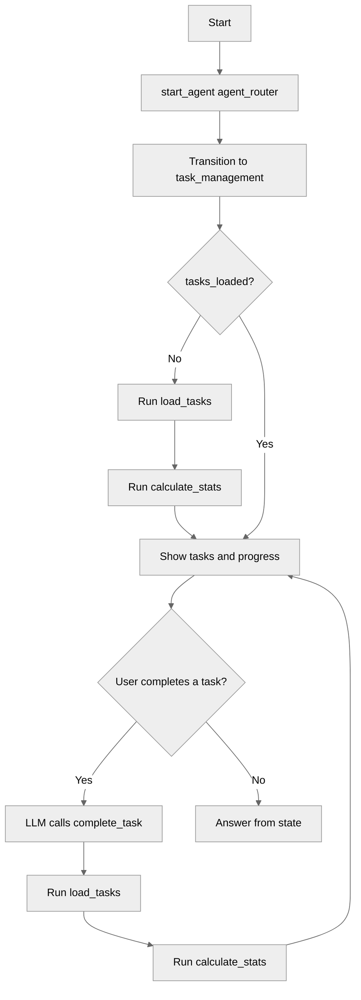

# ComplexStateManagement

## Overview

This recipe demonstrates how to keep a **list of records** in agent state. The agent loads `ASR_Task__c` records into a `list[object]` variable, passes the list to flows to complete tasks and calculate progress, and reloads it after each change.

## Agent Flow



## Key Concepts

- **List of records in a variable**: Store the records returned by a flow in a `list[object]` variable
- **Record type mapping**: Use `complex_data_type_name: "lightning__recordInfoType"` to pass records between actions and flows
- **Loading with `run`**: Load data at the top of the instructions, before the LLM reasons
- **Refreshing after a change**: Chain `run` directives after an action to reload the list and recalculate progress

## How It Works

### Declaring a List of Records

```agentscript
variables:
   tasks: mutable list[object] = []
      description: "Task records currently loaded, with Id, title, status and priority"
```

The list starts empty. Each item is a record with its Id and field values. The agent uses the Ids to complete tasks.

### Passing Records to and from Flows

```agentscript
outputs:
   tasks: list[object]
      description: "ASR_Task__c records with Id, title, status and priority"
      complex_data_type_name: "lightning__recordInfoType"
```

`LoadTasks` returns a collection of `ASR_Task__c` records. Declaring the output as `list[object]` with `lightning__recordInfoType` maps it to the flow's record collection. The input of `calculate_stats` uses the same declaration, so the list can be passed back to a flow with `with tasks = @variables.tasks`.

### Loading the List on the First Message

```agentscript
if @variables.tasks_loaded == False:
   run @actions.load_tasks
      with priority = ""
      set @variables.tasks = @outputs.tasks
   set @variables.tasks_loaded = True
   run @actions.calculate_stats
      with tasks = @variables.tasks
      set @variables.completed_count = @outputs.completed_count
      set @variables.pending_count = @outputs.pending_count
```

This block sits at the top of the instructions, so it runs before the LLM reasons. On the first message it loads the tasks and calculates the progress counts. `tasks_loaded` keeps it from running again.

### Refreshing the List After a Change

```agentscript
complete_task: @actions.complete_task
   available when len(@variables.tasks) > 0
   with task_id = ...
   run @actions.load_tasks
      with priority = ""
      set @variables.tasks = @outputs.tasks
   run @actions.calculate_stats
      with tasks = @variables.tasks
      set @variables.completed_count = @outputs.completed_count
      set @variables.pending_count = @outputs.pending_count
```

The LLM finds the task's Id in the list and calls `complete_task`. After the flow updates the record, `load_tasks` and `calculate_stats` run again to update the list and the counts. `available when` hides the action until tasks are loaded.

## Key Code Snippets

### Complete Variables

```agentscript
variables:
   tasks: mutable list[object] = []
      description: "Task records currently loaded, with Id, title, status and priority"

   tasks_loaded: mutable boolean = False
      description: "Whether the task list has been loaded at least once"

   completed_count: mutable number = 0
      description: "Number of completed tasks in the loaded list"

   pending_count: mutable number = 0
      description: "Number of pending tasks in the loaded list"
```

### Complete Action Definitions

```agentscript
actions:
   load_tasks:
      description: "Loads task records, optionally filtered by priority"
      inputs:
         priority: string
            description: "Priority to filter by: High, Medium or Low. Leave empty for all tasks"
            is_required: False
      outputs:
         tasks: list[object]
            description: "ASR_Task__c records with Id, title, status and priority"
            complex_data_type_name: "lightning__recordInfoType"
      target: "flow://LoadTasks"

   complete_task:
      description: "Marks one task as completed"
      inputs:
         task_id: string
            description: "The Id of the task record to complete"
            is_required: True
      outputs:
         success: boolean
            description: "Whether the task was found and completed"
      target: "flow://CompleteTask"

   calculate_stats:
      description: "Counts completed and pending tasks in a list of task records"
      inputs:
         tasks: list[object]
            description: "ASR_Task__c records to summarize"
            complex_data_type_name: "lightning__recordInfoType"
            is_required: True
      outputs:
         completed_count: number
            description: "Number of completed tasks"
         pending_count: number
            description: "Number of pending tasks"
      target: "flow://CalculateTaskStats"
```

## Try It Out

The sample data includes five tasks.

### Example Interaction

```text
Agent: Hi! I'm your task manager. I can show your tasks, mark them complete, and summarize your progress.

User: Show me my tasks

Agent: Here are your current tasks:
       - Prepare quarterly report: Pending, High priority
       - Review pull requests: Pending, High priority
       - Update onboarding docs: Pending, Medium priority
       - Book team offsite: Completed, Medium priority
       - Clean up old dashboards: Completed, Low priority

User: Mark the quarterly report as done

Agent: The task "Prepare quarterly report" is now marked as completed.

User: How am I doing?

Agent: Out of 5 tasks, you have completed 3 and have 2 still pending.
```

**Behind the Scenes:**

1. The first message runs `load_tasks` and `calculate_stats`: 5 tasks, 2 completed and 3 pending
2. The LLM finds the Id of the quarterly report in `tasks` and calls `complete_task`
3. `CompleteTask` sets the status to Completed, then `load_tasks` and `calculate_stats` run again: 3 completed and 2 pending
4. The progress answer uses `completed_count` and `pending_count`

## What's Next

- **ListVariables**: Iterate through a `list[string]` one item at a time
- **ActionChaining**: Chain actions sequentially with `run`
- **AdvancedReasoningPatterns**: Pass records between several flows

## Testing

### Test Case 1: Load on First Message

- Input: "Show me my tasks"
- Expected: Agent lists the five sample tasks, with 2 completed and 3 pending

### Test Case 2: Complete a Task

- Input: "Mark the quarterly report as done"
- Expected: The task is Completed in the org and the counts change to 3 completed and 2 pending

### Test Case 3: Unknown Task

- Input: "Mark the 'renew passport' task as done"
- Expected: Agent says it could not find the task and shows the loaded tasks

## Notes

- The tasks come from `data/general-task.json`, and the `Agent_Script_Recipes_Data` permission set grants access to `ASR_Task__c`
- `LoadTasks` accepts an optional `priority` filter. This agent passes an empty value to load all tasks, since every action needs at least one input
- Use `len()` to check whether a list is empty, for example `available when len(@variables.tasks) > 0`
- The whole list is added to the instructions, so keep lists small
- `ComplexStateManagementFlowTest` covers the flows
