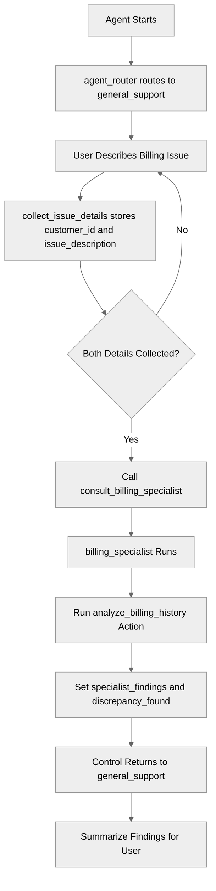

# SubagentDelegation

## Overview

Learn how to use **subagent delegation**, where one subagent calls another subagent as if it were a tool. The delegated subagent does its job and control returns to the caller automatically, so the caller can continue the conversation with the results. Use this pattern when a specialist should do one focused task without taking over the conversation.

## Agent Flow



## Key Concepts

- **Delegation (`@subagent.<name>`)**: Calls another subagent like a sub-routine. Control returns to the caller when it finishes.
- **Transition (`@utils.transition to`)**: A one-way handoff. The original subagent does not resume.
- **Shared variables**: The delegated subagent writes results to variables that the caller reads after control returns.
- **Gated delegation**: `available when` makes sure the specialist is only called once it has the inputs it needs.

## How It Works

### Delegation vs. Transition

Both patterns move the conversation to another subagent. The difference is what happens next:

| Pattern    | Syntax                                | After the target subagent finishes      |
| ---------- | ------------------------------------- | --------------------------------------- |
| Transition | `@utils.transition to @subagent.name` | The conversation stays in the target    |
| Delegation | `@subagent.name`                      | Control returns to the calling subagent |

With transitions, a specialist that should hand back control must explicitly `transition to` the original subagent (see **BidirectionalNavigation**). With delegation, the return is automatic, so the specialist doesn't need to know who called it.

### Defining the Delegation Action

In the caller's `reasoning.actions` block, reference the target subagent directly with `@subagent.<name>`:

```agentscript
consult_billing_specialist: @subagent.billing_specialist
   description: "Consult the billing specialist to analyze a complex billing issue"
   available when @variables.customer_id != "" and @variables.issue_description != ""
```

The LLM picks this action like any other tool. The `available when` guard hides it until **customer_id** and **issue_description** are collected, so the specialist always has what it needs.

### Passing Results Back with Variables

Variables are shared across all subagents. The specialist runs its action and stores the outputs:

```agentscript
reasoning:
   instructions:->
      if not @variables.specialist_findings:
         run @actions.analyze_billing_history
            with customer_id=@variables.customer_id
            with issue_description=@variables.issue_description
            set @variables.specialist_findings = @outputs.findings
            set @variables.discrepancy_found = @outputs.discrepancy_found
```

The `if not` guard makes sure the analysis runs only once. When control returns, **general_support** sees that **specialist_findings** is set and switches its instructions to summarizing the results.

## Key Code Snippets

### Caller Subagent

```agentscript
subagent general_support:
   description: "Answers general account questions and consults the billing specialist for complex billing issues"

   reasoning:
      instructions:->
         if @variables.specialist_findings:
            | The billing specialist has finished. Summarize their findings for the user in plain language.
              Use only these findings; don't add causes or details that aren't in them:
              - Findings: {!@variables.specialist_findings}
              - Discrepancy found: {!@variables.discrepancy_found}
         else:
            | Help the user with their account questions.
              If the user describes a complex billing issue, collect their customer ID and a short description of the issue using {!@actions.collect_issue_details}.
              Once you have both, consult the billing specialist using {!@actions.consult_billing_specialist}.

      actions:
         collect_issue_details: @utils.setVariables
            description: "Store the customer's ID and a short description of their billing issue"
            with customer_id=...
            with issue_description=...

         consult_billing_specialist: @subagent.billing_specialist
            description: "Consult the billing specialist to analyze a complex billing issue"
            available when @variables.customer_id != "" and @variables.issue_description != ""
```

### Delegated Subagent

```agentscript
subagent billing_specialist:
   description: "Billing specialist that analyzes a customer's billing history and reports findings"

   actions:
      analyze_billing_history:
         description: "Reviews the customer's recent invoices for discrepancies"
         inputs:
            customer_id: string
               description: "The customer's ID"
               is_required: True
            issue_description: string
               description: "A short description of the billing issue"
               is_required: True
         outputs:
            findings: string
               description: "Summary of what the analysis found"
            discrepancy_found: boolean
               description: "Whether a discrepancy was found"
         target: "flow://AnalyzeBillingHistory"

   reasoning:
      instructions:->
         if not @variables.specialist_findings:
            run @actions.analyze_billing_history
               with customer_id=@variables.customer_id
               with issue_description=@variables.issue_description
               set @variables.specialist_findings = @outputs.findings
               set @variables.discrepancy_found = @outputs.discrepancy_found

         | You are the billing specialist. Your analysis is complete: {!@variables.specialist_findings}
```

Notice there is no `transition to @subagent.general_support` anywhere in the specialist.

## Try It Out

### Example Interaction

```text
Agent: Hi! I can help with your account. For complex billing issues, I'll consult our billing specialist.

User: I think I was charged twice this month.

Agent: I'm sorry about that. Can you share your customer ID so our billing specialist can take a look?

User: It's CUST-12345.

Agent: Thanks! Our billing specialist reviewed your account. Your last invoice was charged twice for the
       same subscription, and a refund of the duplicate charge has been requested.
```

### Behind the Scenes

1. **agent_router** transitions to **general_support**
2. `collect_issue_details` stores **customer_id** and **issue_description**
3. With both set, `consult_billing_specialist` becomes available and the LLM calls it
4. **billing_specialist** runs `analyze_billing_history` and stores the results in variables
5. Control returns to **general_support**, which now sees **specialist_findings** and summarizes them

## What's Next

- **BidirectionalNavigation**: Compare with explicit transitions to a specialist and back
- **MultiSubagentNavigation**: Learn one-way transitions between subagents
- **ComplexStateManagement**: Manage state shared across subagent boundaries
- **AvailableWhenFiltering**: Learn more about gating actions with `available when`

## Testing

### Test Case 1: Delegation Happy Path

- Describe a billing issue and give a customer ID
- Verify `consult_billing_specialist` is called only after both variables are set
- Verify the agent summarizes the specialist's findings without the user having to ask again

### Test Case 2: General Question

- Ask a general account question (e.g. "How do I update my email?")
- Verify the specialist is not consulted

### Test Case 3: Missing Details

- Describe a billing issue without giving a customer ID
- Verify the agent asks for the customer ID before consulting the specialist

## Notes

- The delegated subagent's own reply is not sent to the user. After it finishes, the caller reasons again with the updated variables and its response is the one the user sees. This is why the specialist stores its results in variables instead of just replying.
- Every user message starts at **agent_router**. Its instructions tell it to always route to **general_support**, because if the router answered a follow-up (such as the customer ID) directly, the delegation would never happen.
